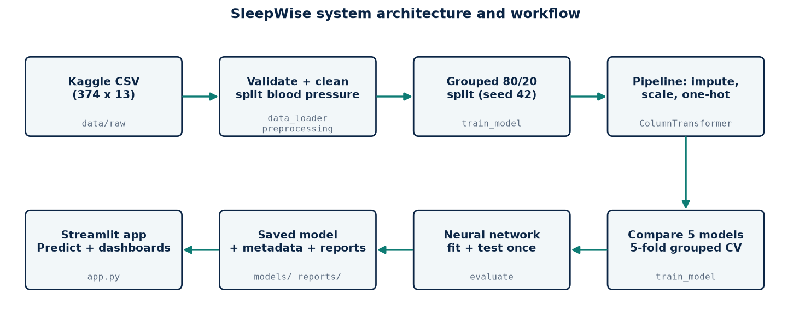
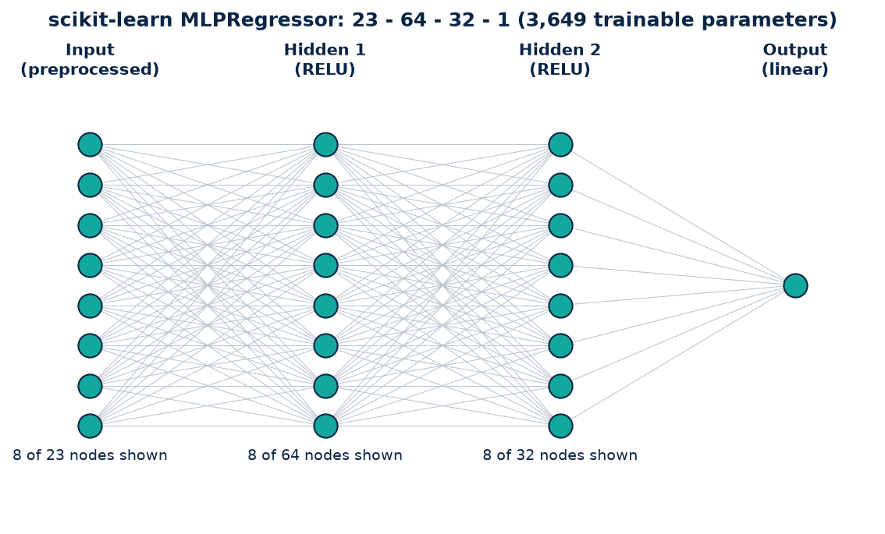
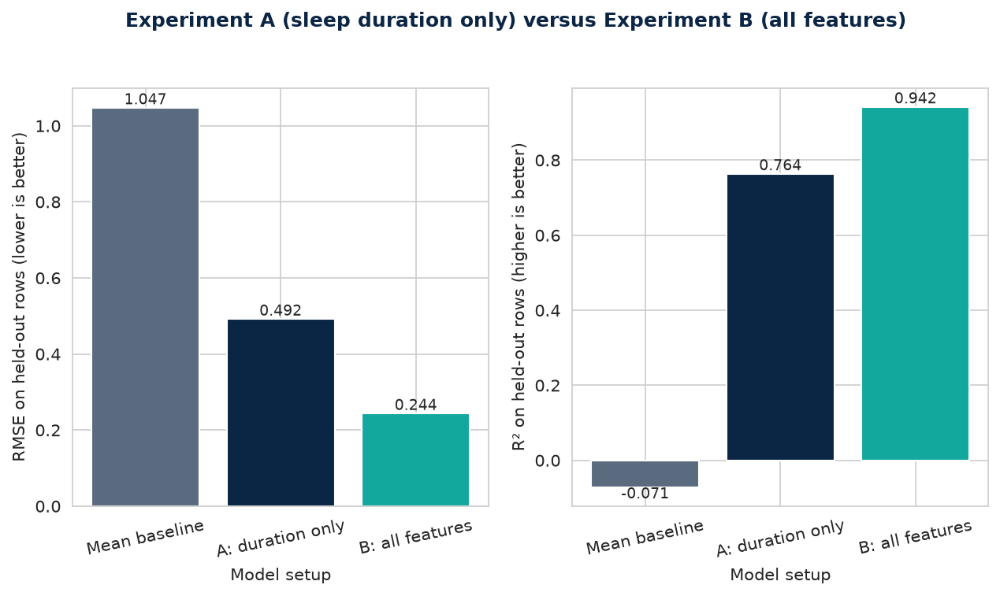
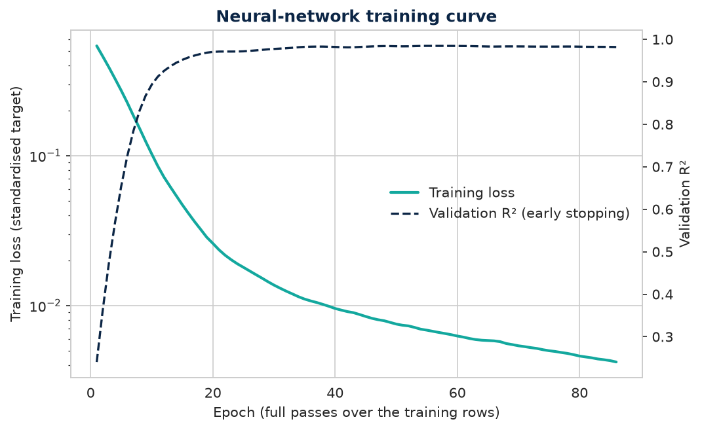
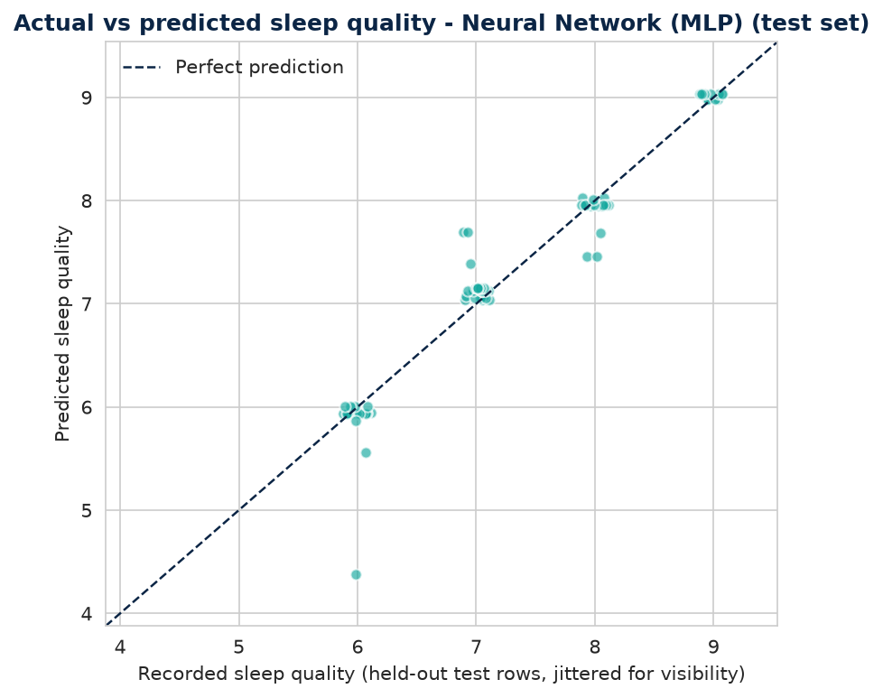
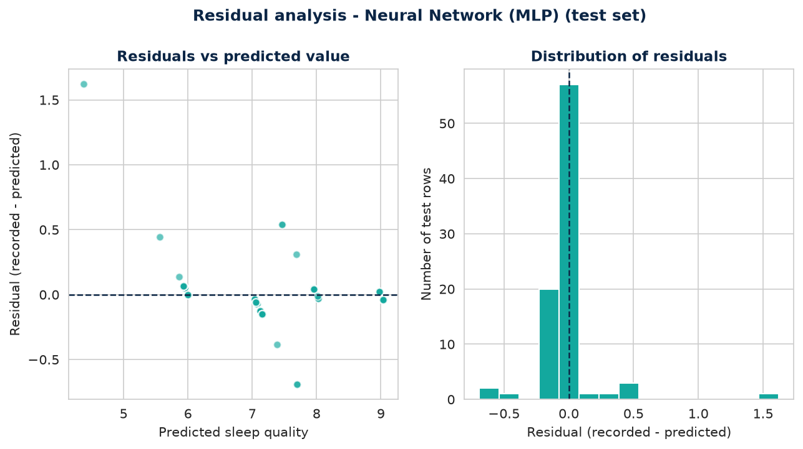

# SleepWise AI: estimating sleep quality with a neural network

**Course:** BDA404-5N Artificial Neural Networks and Deep Learning, ESE (CIA-III) Project Implementation and Deployment
**Student:** Rohan Raphael Arora, Roll No. 24215220 (individual project)
**Presentation:** 29 October 2026, 1-hour session, 10 to 12 minutes per student including Q&A
**Repository / deployment link:** `<add your GitHub URL>` / `<add your Streamlit URL>`

---

## 1. Problem statement, objectives and requirements

### 1.1 Problem and motivation
Sleep quality is related to many lifestyle and health factors, but each factor is usually studied alone. This project asks a narrow, testable question: **how well can a feed-forward neural network estimate a person's recorded sleep-quality score from the other characteristics recorded alongside it** (age, gender, occupation, sleep duration, physical activity, stress, BMI category, heart rate, daily steps, blood pressure)?

It is a regression task on a small tabular dataset. It is *not* forecasting future sleep and *not* diagnosing sleep disorders.

### 1.2 Objectives
| ID | Objective | Where it is met |
|---|---|---|
| O1 | Validate and clean the dataset reproducibly, without inventing data | `data_loader.py`, `preprocessing.py` |
| O2 | Design and train a neural-network regressor, and also implement one from scratch to show back-propagation | `train_model.py`, `numpy_mlp.py` |
| O3 | Compare it fairly with classical models (linear, tree, forest) and a mean baseline | cross-validation table, section 4 |
| O4 | Evaluate honestly on held-out data, avoiding leakage from repeated rows | grouped split, section 2.4 |
| O5 | Deploy an interactive application with input validation | `app.py`, `DEPLOYMENT.md` |
| O6 | Explain what the model relies on, without causal claims | permutation importance |
| O7 | Test whether sleep duration alone is enough (Experiment A) against all clues (Experiment B) | section 2.5 |
| O8 | Keep general sleep-health education, with verifiable sources, separate from the model | `sleep_education.py`, Potential Effects page |

### 1.3 Expected outcomes
A trained and saved neural network; a metrics report (MAE, RMSE, R²) against a baseline; a dark, narrative Streamlit dashboard (Home, Sleep Analysis, Behavioural Insights, Potential Effects, Model Performance, About); tests; documentation.

### 1.4 Scope
In scope: the 11 input characteristics in the dataset, one-shot estimation, a local or cloud-hosted app.
Out of scope: forecasting, diagnosis, medical advice, features absent from the data (screen time, caffeine, bedtime consistency), probability or confidence scores.

### 1.5 Requirements
| ID | Functional requirement |
|---|---|
| FR1 | Load a CSV from a configurable path and fail with a helpful message if it is missing or has no target column |
| FR2 | Report rows, columns, missing values and duplicates |
| FR3 | Split blood pressure ("126/83") into systolic and diastolic numbers |
| FR4 | Exclude Person ID, the target and Sleep Disorder from model inputs |
| FR5 | Train, cross-validate and compare models; save the deployed model and its metadata |
| FR6 | Predict from a validated form; reject out-of-range or unknown values; warn on extrapolation |
| FR7 | Show real metrics and figures, never hard-coded results |
| FR8 | Keep working (with instructions) if training has not been run |
| FR9 | Require only sleep duration; treat lifestyle inputs as optional (two models: duration only, and all clues) |
| FR10 | Show educational sleep guidance with sources, labelled as not model output, and without probabilities |

| ID | Non-functional requirement | Evidence |
|---|---|---|
| NFR1 | Reproducible: fixed seed, saved dataset hash | `random_state=42`, SHA-256 in `reports/dataset_schema.json` |
| NFR2 | Fast: prediction under 100 ms | measured about 5.5 ms per prediction (build machine) |
| NFR3 | Quick to rebuild: full training under a minute | `python train.py` took about 9.7 s (build machine) |
| NFR4 | Portable: Windows, plain Python, no GPU | CPU-only scikit-learn and NumPy |
| NFR5 | Honest: no clinical claims | stated in the app, README and report |

---

## 2. System design, architecture and methodology

### 2.1 Architecture

Layers: **data** (CSV) → **processing** (`data_loader`, `preprocessing`) → **modelling** (`train_model`, `numpy_mlp`) → **evaluation** (`evaluate`, `explainability`) → **artefacts** (`models/`, `reports/`) → **application** (`app.py` using `predict.py`).

### 2.2 Technology stack
Python 3.11+, pandas and NumPy (data), scikit-learn (pipeline, MLP, baselines, cross-validation), Matplotlib and Seaborn (figures), Streamlit (interface), Joblib (model persistence), pytest (tests), GitHub and Streamlit Community Cloud (deployment).

### 2.3 Neural-network design

| Item | Choice | Reason |
|---|---|---|
| Layers | 23 → 64 → 32 → 1 | 23 inputs after encoding; two hidden layers are enough for tabular data of this size |
| Hidden activation | ReLU | avoids saturating gradients; cheap; standard for feed-forward regression |
| Output | one linear unit | unbounded real-valued regression target |
| Loss | squared error | matches RMSE/MAE reporting; regression |
| Optimiser | Adam, learning rate 0.001 | adaptive step sizes; robust default |
| Regularisation | L2 penalty α = 0.001, early stopping | small dataset, high overfitting risk |
| Target | standardised for training, restored for prediction | keeps gradients well scaled |
| Trainable parameters | 3,649 | for 288 training rows (only 87 distinct) the network is heavily over-parameterised, which is why regularisation matters |

### 2.4 Methodology
1. **Cleaning:** strip text, merge the "Normal"/"Normal Weight" BMI spellings, parse blood pressure. Nothing is imputed here.
2. **Leakage control:** Person ID (identifier), Quality of Sleep (target) and Sleep Disorder (a recorded outcome) are excluded.
3. **Pipeline:** median imputation + standardisation for numbers; most-frequent imputation + one-hot (unseen categories ignored) for text. Fitted on training rows only because it lives inside the scikit-learn `Pipeline`.
4. **Grouped split:** the file has 242 rows that repeat another row's values, leaving 109 distinct input combinations. A random split would put a twin of 93% of test rows in training. Rows with identical inputs are therefore kept together (`GroupShuffleSplit`, 80/20, seed 42).
5. **Model comparison:** 5-fold grouped cross-validation on the training split only, for a mean baseline, Linear Regression, Decision Tree, Random Forest, the scikit-learn neural network and the NumPy neural network.
6. **Deployment choice:** because this is a neural-network project, the scikit-learn network is the deployed model *by design*, decided before any test result was seen. The cross-validation winner is reported next to it. See `config.DEPLOYED_MODEL`.
7. **Final evaluation:** the deployed model is evaluated once on the held-out rows. Test results for the other models are shown for transparency only.
8. **Explainability:** permutation importance on the test rows (model reliance, not causation).

### 2.5 Experiments A and B
Both use the same rows, the same grouped split and the same cross-validation, so they are directly comparable.
* **Experiment A:** `Sleep Duration` is the only input. The candidate with the lowest cross-validated RMSE (Decision Tree) is fitted and tested once.
* **Experiment B:** all 11 inputs, deployed neural network.

| Setup | MAE | RMSE | R² |
|---|---|---|---|
| Mean baseline | 0.919 | 1.047 | -0.071 |
| A: sleep duration only (Decision Tree) | 0.370 | 0.531 | 0.724 |
| B: all inputs (Neural Network (MLP)) | 0.121 | 0.244 | 0.942 |

Reading: sleep duration alone is clearly informative (R² 0.72 against -0.07 for the baseline) but the other inputs roughly halve the RMSE. Only 27 distinct sleep-duration values exist in the training rows and the file is highly structured, so neither result shows that individual predictions are reliable. The application therefore uses the duration-only model only when the user chooses not to enter other details.

### 2.6 Educational module (not machine learning)
`sleep_education.py` holds paraphrased guidance from the CDC, NIH/NHLBI and the AASM/SRS consensus statement: age-specific reference ranges, cautious duration descriptions and a list of effects, each with an evidence type, a source link and a disclaimer. Links and wording were checked on 28 October 2026. Nothing there is a probability and none of it is predicted by the model.

---

## 3. Implementation

| Module | Responsibility |
|---|---|
| `config.py` | paths, seeds, column names, input ranges, deployed-model switch |
| `data_loader.py` | CSV loading, validation, schema report with SHA-256 |
| `preprocessing.py` | cleaning, feature roles, group ids, `ColumnTransformer` |
| `numpy_mlp.py` | neural network from scratch: forward pass, back-propagation, Adam |
| `train_model.py` | split, cross-validation, fitting, test evaluation, saving artefacts |
| `evaluate.py`, `diagrams.py` | metrics, residual/actual-vs-predicted/training-curve plots, architecture diagrams |
| `explainability.py` | permutation importance |
| `predict.py` | input validation, one-row frame, prediction (full or duration-only variant), display clipping |
| `sleep_education.py` | age guidance, duration descriptions and effects with verified sources |
| `app.py` | Streamlit interface (reads artefacts only) |

### 3.1 Neural-network mathematics (as implemented in `numpy_mlp.py`)
Forward pass: a₀ = x; for each hidden layer zₗ = Wₗ aₗ₋₁ + bₗ and aₗ = max(0, zₗ); output ŷ = z_L (linear).
Loss: L = ½ · mean((ŷ − y)²) + ½ · λ · Σ‖Wₗ‖².
Back-propagation: δ_L = (ŷ − y) / n; ∇Wₗ = aₗ₋₁ᵀ δₗ + λWₗ; ∇bₗ = Σ δₗ; δₗ₋₁ = (δₗ Wₗᵀ) ⊙ 1[zₗ₋₁ > 0].
Adam: mₜ = β₁mₜ₋₁ + (1−β₁)g; vₜ = β₂vₜ₋₁ + (1−β₂)g²; θ ← θ − η · m̂ₜ / (√v̂ₜ + ε).
Initialisation: He normal, W ~ N(0, 2 / fan_in).

**Verification:** `tests/test_neural_network.py` compares the analytic gradients with central finite differences. The maximum relative error was about 1e-7, so the back-propagation is correct.

### 3.2 Training behaviour of the deployed network

Training stopped after 86 epochs through early stopping. The internal validation R² reached 0.985, but that validation slice is a random 15% of training rows (not grouped), so it is optimistic. Do not quote it as a generalisation estimate.

---

## 4. Testing, results and evaluation

### 4.1 Tests
44 automated unit tests (see `docs/TEST_REPORT.md`) plus a manual application checklist. Covered: loading and error handling, missing target, blood-pressure parsing, exclusions, imputation, unseen categories, fitting on training data only, group ids, training/prediction column consistency, prediction validity, missing model files, input validation, and numerical gradient checking.

### 4.2 Cross-validation (training split only)
| Model | RMSE (mean ± std) | MAE | R² |
|---|---|---|---|
| Baseline (training mean) | 1.268 ± 0.146 | 1.123 | -0.216 |
| Linear Regression | 0.338 ± 0.050 | 0.190 | 0.914 |
| Decision Tree | 0.295 ± 0.120 | 0.110 | 0.930 |
| Random Forest | 0.237 ± 0.100 | 0.092 | 0.955 |
| Neural Network (MLP) | 0.268 ± 0.111 | 0.120 | 0.933 |
| Neural Network (NumPy, from scratch) | 0.243 ± 0.061 | 0.128 | 0.953 |

### 4.3 Held-out test set (86 rows, 22 distinct input combinations)
| Model | MAE | RMSE | R² |
|---|---|---|---|
| Linear Regression | 0.187 | 0.392 | 0.850 |
| Decision Tree | 0.111 | 0.311 | 0.905 |
| Random Forest | 0.063 | 0.195 | 0.963 |
| Neural Network (MLP) (deployed) | 0.121 | 0.244 | 0.942 |
| Neural Network (NumPy, from scratch) | 0.134 | 0.286 | 0.920 |
| Baseline: training mean | 0.919 | 1.047 | -0.071 |

### 4.4 Interpretation
* **The deployed neural network clearly beats the baseline** (RMSE 0.244 vs 1.047) and typically misses by about 0.12 points (MAE).
* **It is not the best model here.** The Random Forest has lower cross-validated RMSE (0.237 vs 0.268) and lower test error (RMSE 0.195 vs 0.244). This is consistent with published observations that tree ensembles often match or beat neural networks on small tabular data (Grinsztajn et al., 2022), but this project did not test why. With 22 distinct test combinations and cross-validation standard deviations around 0.1, the gap between the two is suggestive, not proven.
* **Overfitting gap:** training R² 0.987 vs test R² 0.942.
* **Repeated rows inflate naive evaluation:** a plain random split would report R² 0.992 because 93% of its test rows have an identical twin in training.
* **What each model relies on** (permutation importance, increase in RMSE when a column is shuffled). Neural network: Sleep Duration (0.31), Occupation (0.19), Diastolic BP (0.19), Stress Level (0.18), Gender (0.15). Random Forest: Sleep Duration (0.83), Stress Level (0.26), BMI Category (0.07), Occupation (0.05). The network spreads its reliance over more inputs (occupation, gender, diastolic blood pressure) that the forest barely uses. A possible reason is that it memorises patterns tied to specific combinations in a tiny dataset; this was not tested.
* Importance is **model reliance, not causation**.

### 4.5 Performance and limits
Prediction takes about 5.5 ms; training the full set of models and generating all figures takes about 9.7 s on the build machine.

---

## 5. Deployment

* **Local:** `python train.py` then `streamlit run app.py` (see README).
* **Cloud:** GitHub repository + Streamlit Community Cloud, main file `app.py` (see `DEPLOYMENT.md`).
* **Artefacts are committed** (model, metadata, reports, figures, dataset) so the deployed app starts immediately.
* **Self-healing start-up:** if the saved model is missing or was built with a different scikit-learn version, `app.py` retrains it once from the bundled CSV (about 9.7 s locally) instead of crashing.
* **Input safety:** every field is validated against hard limits and known categories; values outside the training range produce a warning that the estimate is an extrapolation.
* **Deployment link:** `<add your Streamlit URL after deploying>`

---

## 6. Conclusion and future scope

**Achievements.** A reproducible pipeline; a neural network designed, regularised, trained and deployed; a second network built from scratch with verified back-propagation; fair comparison against four reference models; leakage-aware evaluation; a validated, deployable application; tests and documentation.

**Limitations.** Small dataset of unverified provenance with only 109 distinct input combinations; test set of 22 combinations; associations only; narrow value ranges; no uncertainty estimate; integer targets between 4 and 9; the neural network does not beat the Random Forest here.

**Future scope.** Validate on an independent dataset; add prediction intervals (for example conformal prediction or deep ensembles); tune the architecture with nested cross-validation; try larger ensembles of networks; test embeddings for occupation; run fairness checks across gender and occupation; a separate, justified Sleep Disorder classification experiment.

---

## 7. Individual contribution

*(Fill this in with your own words before submitting. The course requires you to explain your individual contribution.)*

* What I designed:
* What I implemented:
* What I tested and deployed:
* What I took from external sources (libraries, dataset, examples) and how I adapted it:

## 8. References

*(Check each entry against its source before submitting.)*
1. Rumelhart, D. E., Hinton, G. E., & Williams, R. J. (1986). Learning representations by back-propagating errors. *Nature*, 323, 533-536.
2. Kingma, D. P., & Ba, J. (2015). Adam: A method for stochastic optimization. *ICLR 2015*. arXiv:1412.6980.
3. Glorot, X., Bordes, A., & Bengio, Y. (2011). Deep sparse rectifier neural networks. *AISTATS 2011*, PMLR 15, 315-323.
4. He, K., Zhang, X., Ren, S., & Sun, J. (2015). Delving deep into rectifiers: Surpassing human-level performance on ImageNet classification. *ICCV 2015*, 1026-1034.
5. Hornik, K., Stinchcombe, M., & White, H. (1989). Multilayer feedforward networks are universal approximators. *Neural Networks*, 2(5), 359-366.
6. Goodfellow, I., Bengio, Y., & Courville, A. (2016). *Deep Learning*. MIT Press.
7. Prechelt, L. (1998). Early stopping - but when? In *Neural Networks: Tricks of the Trade*, LNCS 1524, Springer, 55-69.
8. Breiman, L. (2001). Random forests. *Machine Learning*, 45(1), 5-32.
9. Hastie, T., Tibshirani, R., & Friedman, J. (2009). *The Elements of Statistical Learning* (2nd ed.). Springer.
10. Grinsztajn, L., Oyallon, E., & Varoquaux, G. (2022). Why do tree-based models still outperform deep learning on typical tabular data? *NeurIPS 2022 Datasets and Benchmarks Track*.
11. Fisher, A., Rudin, C., & Dominici, F. (2019). All models are wrong, but many are useful: learning a variable's importance by studying an entire class of prediction models simultaneously. *JMLR*, 20(177), 1-81.
12. Pedregosa, F., et al. (2011). Scikit-learn: Machine learning in Python. *JMLR*, 12, 2825-2830.
13. Kaggle, "Sleep Health and Lifestyle Dataset": `<add URL, author and licence from the Kaggle page; see DATA_SOURCES.md>`
14. Streamlit documentation, https://docs.streamlit.io
